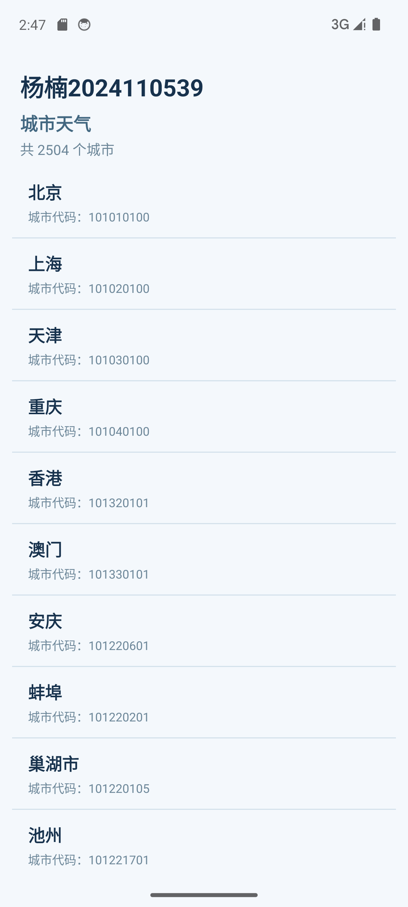
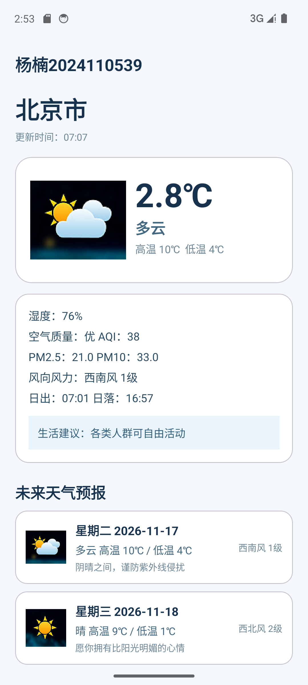

# 网络天气应用

Android 移动应用开发实验八项目。

- 姓名：杨楠
- 学号：2024110539
- 开发语言：Kotlin
- UI：XML 布局

## 功能

- 使用后台线程读取本地 `res/raw/citycode.json` 城市数据。
- 使用 Gson 解析城市列表并显示城市名称和城市代码。
- 点击城市后进入天气详情界面。
- 使用 Volley 请求天气服务，并使用 Gson 解析返回数据。
- 显示当前温度、天气类型、湿度、空气质量、AQI、PM2.5、PM10、风向风力、日出日落和生活建议。
- 根据天气类型显示对应图标。
- 显示未来 15 天天气预报。

## 运行截图

### 城市列表



### 天气详情



## 项目结构

```text
app/src/main/
├── java/com/example/yn/weatherapp/
│   ├── MainActivity.kt
│   ├── DetailActivity.kt
│   ├── City.kt
│   ├── CityAdapter.kt
│   └── WeatherModels.kt
└── res/
    ├── raw/citycode.json
    ├── drawable/
    └── layout/
```

## 运行方式

1. 使用 Android Studio 打开项目根目录。
2. 等待 Gradle Sync 完成。
3. 启动 Android 模拟器或连接 Android 设备。
4. 点击 Run `app`。

最低支持 Android 7.0（API 24）。

## 主要依赖

- Volley 1.2.1
- Gson 2.13.2

## 天气接口

```text
http://t.weather.itboy.net/api/weather/city/{城市代码}
```
